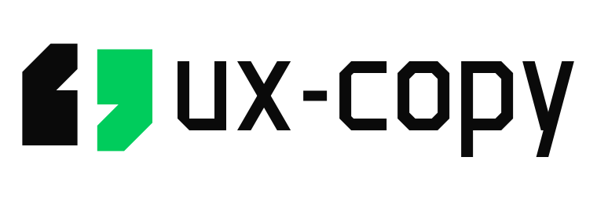

<p align="center">
  <picture>
    <source media="(prefers-color-scheme: dark)" srcset="assets/logo-horizontal-dark.svg" />
    <source media="(prefers-color-scheme: light)" srcset="assets/logo-horizontal-light.svg" />
    
  </picture>
</p>

<p align="center">
  <a href="SKILL.md"></a>
  <a href="references/locale-and-code-rules.md"></a>
  <a href="CHANGELOG.md"></a>
  <a href="LICENSE"></a>
</p>

# ux-copy

`ux-copy` là Agent Skill viết mới, rà soát và tái cấu trúc nội dung giao diện (UX writing và microcopy) bằng tiếng Việt và tiếng Anh trên văn bản thuần, Markdown, JSON i18n và mã nguồn UI (JSX/TSX/HTML).

## Tính năng chính

- Viết mới bộ microcopy từ đầu theo 4 ngữ cảnh giọng điệu (Success, Error, Warning, Informative) và các mẫu thành phần UI (CTA, thông báo lỗi, trạng thái trống, hộp thoại xác nhận, biểu mẫu, tooltip, tiến trình, onboarding).
- Rà soát, dọn dẹp copy thừa (Subtract Before Rewriting) và sửa chuỗi giao diện có sẵn trên bảng copy, tệp JSON i18n và component JSX/TSX/HTML theo thứ tự ưu tiên từ an toàn mã nguồn đến typography.
- Tách riêng quy chuẩn ngữ pháp và định dạng từng ngôn ngữ: Sentence Case, dấu ngoặc kép cong, dấu ba chấm đơn, loại bỏ câu bị động và định dạng ngày/số cho tiếng Việt; câu chủ động, dạng rút gọn tự nhiên và định dạng số chuẩn cho tiếng Anh.
- Kiểm tra microcopy trợ năng (`aria-label`, `alt`, nhãn liên kết có nghĩa), tránh nối chuỗi i18n trong code và cân chỉnh độ dài nhãn khi dịch sang tiếng Việt cho nút/tab hẹp.
- Bảo toàn cấu trúc key i18n, cú pháp biến động (`{var}`, `{{var}}`, `%s`, ICU, thẻ rich-text), props và dấu nháy cú pháp khi chỉnh sửa trực tiếp; không tự ý xóa key i18n hoặc thẻ component ngoài ranh giới an toàn.
- Cung cấp bộ tiêu chí và mẫu đầu vào kiểm thử trong `evals/` để đánh giá lại chất lượng skill sau khi cập nhật.

## Chế độ làm việc

Tương thích với các coding agent hỗ trợ chuẩn AgentSkills.

| Chế độ | Đầu vào thường gặp | Đầu ra |
| :--- | :--- | :--- |
| **Viết mới (Draft)** | Mô tả màn hình, luồng thao tác, loại thông báo | Bộ microcopy nhóm theo thành phần kèm biến động `{...}` |
| **Rà soát & Sửa (Audit)** | Văn bản, Markdown, JSON i18n, tệp JSX/TSX/HTML | Bảng đối chiếu Trước/Sau hoặc tệp đã sửa giữ nguyên cú pháp |

## Cài đặt

### Qua Skills CLI (Khuyên dùng)

Cài trực tiếp từ GitHub qua [`skills`](https://skills.sh/).

Cài theo dự án:

```bash
npx skills add dexter826/ux-copy
```

Cài global (không hỏi xác nhận):

```bash
npx skills add dexter826/ux-copy -g -y
```

### Cài thủ công bằng Git

Sao chép repository vào thư mục skills của agent để thư mục có tên `ux-copy`.

Global trên Unix/macOS (`~/.agents/skills`):

```bash
mkdir -p ~/.agents/skills && git clone https://github.com/dexter826/ux-copy.git ~/.agents/skills/ux-copy
```

Theo dự án trên Unix/macOS (`.agents/skills`):

```bash
mkdir -p .agents/skills && git clone https://github.com/dexter826/ux-copy.git .agents/skills/ux-copy
```

Global trên Windows PowerShell (`$HOME\.agents\skills`):

```powershell
New-Item -ItemType Directory -Force -Path "$HOME\.agents\skills" | Out-Null
git clone https://github.com/dexter826/ux-copy.git "$HOME\.agents\skills\ux-copy"
```

## Cách sử dụng

Skill tự kích hoạt khi bạn yêu cầu viết, dịch, kiểm tra hoặc sửa chữ giao diện, nút bấm, thông báo lỗi, trạng thái trống, hộp thoại xác nhận, biểu mẫu, tooltip hoặc tệp i18n. Bạn cũng có thể gọi trực tiếp `/ux-copy` kèm ngữ cảnh hoặc tệp mục tiêu.

### Ví dụ prompt

```text
Viết microcopy song ngữ VI/EN cho hộp thoại xác nhận xóa dự án và trạng thái lỗi mất kết nối.
```

```text
Kiểm tra và sửa lỗi UX copy trong src/locales/vi.json, giữ nguyên toàn bộ key và biến {{...}}.
```

### Cấu trúc repository

```text
ux-copy/
├── SKILL.md                         # Hướng dẫn điều phối chính và quy trình 2 chế độ
├── README.md                        # Tài liệu giới thiệu và hướng dẫn cài đặt
├── CHANGELOG.md                     # Nhật ký thay đổi theo chuẩn Keep a Changelog
├── LICENSE                          # Giấy phép MIT
├── .gitignore                       # Loại trừ workspace tạm, gói .skill và file OS/IDE
├── .gitattributes                   # Chuẩn hóa ký tự xuống dòng LF
├── assets/                          # Logo SVG tối giản cho theme sáng và tối
├── references/
│   ├── component-patterns.md        # Chi tiết 8+ mẫu thành phần UI và bảng Do's & Don'ts
│   └── locale-and-code-rules.md     # Quy chuẩn tiếng Việt, tiếng Anh và an toàn mã nguồn/i18n
└── evals/
    ├── evals.json                   # Kịch bản kiểm thử và tiêu chí đánh giá (assertions)
    └── files/                       # Tệp mẫu đầu vào (vi.json, WorkspaceDangerModal.tsx, BillingSettingsCard.tsx)
```

## Giấy phép

Phân phối theo giấy phép [MIT](LICENSE).
